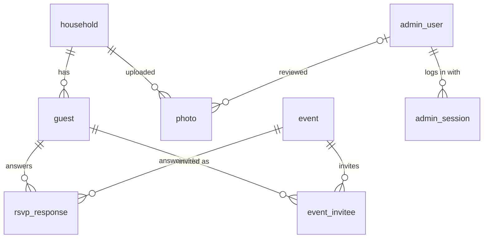

# Core data model

The database schema behind address collection, the RSVP, and the photo gallery. The models and the first Alembic migration are written from this document. Decisions it builds on: D2 (SQLModel + Alembic), D3 (Postgres), D5 (R2), D8 (guest lookup), and D10 (data model conventions).

## Overview

- **household** is the unit that's invited: one invitation, one RSVP, one mailing address, one personal link.
- **guest** is a person in a household. Name lookup matches against guests.
- **event** is a gathering on the weekend (welcome party, rehearsal, wedding, after party).
- **event_invitee** lists who's invited to an invited-only event, such as the rehearsal.
- **rsvp_response** holds one answer per guest per event.
- **photo** is a guest upload stored in R2.
- **admin_user** and **admin_session** are the two admin accounts and their logins (D2).

There's one setting, `RSVP_DEADLINE`, which sets when guests can no longer change their answers.

## Conventions

- **IDs** are auto-increment integers. Guests never reach a row by its ID, only through their link token or the household cookie, so a guessable ID exposes nothing.
- **Timestamps** are `timestamptz`, stored in UTC.
- **Enums** are Postgres enums or `CHECK` constraints limited to the listed values.
- **Soft delete:** `household`, `guest`, and `event` have a nullable `deleted_at`. A row with `deleted_at` set is *removed*. See [Removing things](#removing-things).
- **Required** means `NOT NULL`. Fields not marked required are nullable.

## Tables

### household

| Field | Type | Constraints | Notes |
|---|---|---|---|
| `id` | int | PK | |
| `display_name` | text | required | The greeting on the site and the envelope name line, e.g. "Jane Doe & John Smith". Set by the couple. |
| `link_token` | text | required, unique | The personal link and QR. See [Link token](#link-token). |
| `address_line1` | text | | **PII.** Empty until the household submits. The form requires it. |
| `address_line2` | text | | **PII.** Optional, e.g. "Apt 4B". |
| `city` | text | | **PII.** |
| `state` | char(2) | `CHECK` in fixed list | **PII.** The 50 states, DC, US territories, and the military codes AA, AE, and AP. |
| `zip` | text | `CHECK` 5 digits or ZIP+4 | **PII.** |
| `address_submitted_at` | timestamptz | | Set on each submission. |
| `plus_one_allowance` | int | required, default 0, `CHECK >= 0` | How many extra guests this household may add on the RSVP form. |
| `rsvp_first_submitted_at` | timestamptz | | When the RSVP form was first sent. |
| `rsvp_updated_at` | timestamptz | | The last change to any answer. |
| `created_at` | timestamptz | required, default `now()` | |
| `deleted_at` | timestamptz | | Soft delete. |

- Addresses are US only. They live on `household` rather than in a separate table because each household has exactly one, and nothing else has an address.
- A resubmission replaces the address and updates `address_submitted_at`. The address form never shows a stored address back.

### guest

| Field | Type | Constraints | Notes |
|---|---|---|---|
| `id` | int | PK | |
| `household_id` | int | required, FK → `household.id` | |
| `first_name` | text | required | **PII.** Shown on the site. |
| `last_name` | text | required | **PII.** |
| `nickname` | text | | **PII.** One per guest, used only to search. Never shown to guests. Editable in the dashboard. |
| `added_by_household` | bool | required, default false | True for plus-ones added on the RSVP form. Not used for lookup. |
| `dietary_notes` | text | | **PII.** Optional, from the RSVP form. Admin only. |
| `created_at` | timestamptz | required, default `now()` | |
| `deleted_at` | timestamptz | | Soft delete. |

### event

| Field | Type | Constraints | Notes |
|---|---|---|---|
| `id` | int | PK | |
| `name` | text | required | |
| `starts_at` | timestamptz | required | |
| `location` | text | | |
| `description` | text | | |
| `audience` | enum | required, default `'everyone'` | `'everyone'` or `'invited'`. Invited-only events use `event_invitee`. |
| `rsvp_enabled` | bool | required | Whether the event appears on the RSVP form. |
| `allows_maybe` | bool | required, default false | Whether "maybe" is an allowed answer. |
| `created_at` | timestamptz | required, default `now()` | |
| `deleted_at` | timestamptz | | Soft delete. |

The planned events, as an example of how the flags combine:

| Event | `audience` | `rsvp_enabled` | `allows_maybe` |
|---|---|---|---|
| Welcome party | everyone | yes | to decide |
| Rehearsal | invited | no | no |
| Wedding | everyone | yes | no |
| After party | everyone | yes | to decide |

A possible day-after event is just another row, added if it happens. `allows_maybe` can be changed at any time without touching the schema.

### event_invitee

| Field | Type | Constraints | Notes |
|---|---|---|---|
| `event_id` | int | PK, FK → `event.id` | |
| `guest_id` | int | PK, FK → `guest.id` | |

- Rows exist only for events with `audience = 'invited'`.
- Invitations are per guest, not per household, so the wedding party can be invited without their whole households.

### rsvp_response

| Field | Type | Constraints | Notes |
|---|---|---|---|
| `guest_id` | int | PK, FK → `guest.id` | |
| `event_id` | int | PK, FK → `event.id` | |
| `status` | enum | required | **PII.** `'yes'`, `'no'`, or `'maybe'`. |

Changing an answer overwrites it. There's no history table. The household's `rsvp_first_submitted_at` and `rsvp_updated_at` show when it last changed.

### photo

| Field | Type | Constraints | Notes |
|---|---|---|---|
| `id` | int | PK | |
| `household_id` | int | required, FK → `household.id` | The uploader. |
| `r2_key` | text | required, unique | **PII** (it points to the photo). Object key in the private R2 bucket. |
| `content_type` | text | required | |
| `size_bytes` | bigint | required | |
| `uploaded_at` | timestamptz | required, default `now()` | |
| `status` | enum | required, default `'pending'` | `'pending'`, `'approved'`, or `'rejected'`. |
| `reviewed_at` | timestamptz | | |
| `reviewed_by` | int | FK → `admin_user.id`, `ON DELETE SET NULL` | |

Size limits and storage rules for photos belong to the photo-uploads spec.

### admin_user

| Field | Type | Constraints | Notes |
|---|---|---|---|
| `id` | int | PK | |
| `email` | text | required, unique | Stored lowercased. |
| `password_hash` | text | required | |
| `created_at` | timestamptz | required, default `now()` | |

### admin_session

| Field | Type | Constraints | Notes |
|---|---|---|---|
| `id` | text | PK | SHA-256 of the cookie token, so a leaked database can't be replayed as a login. |
| `admin_user_id` | int | required, FK → `admin_user.id`, `ON DELETE CASCADE` | |
| `created_at` | timestamptz | required, default `now()` | |
| `expires_at` | timestamptz | required | |

## How guests get in

There are two ways in, and both lead to the same place:

1. **The personal link or QR** carries the household's `link_token`. The couple copies it from the dashboard and sends it by hand, and can print the QR on invitations.
2. **Name lookup**, for guests who only have the paper invitation.

Either way, the backend sets a signed cookie that identifies the household. No table is involved. The address form, the RSVP form, the gallery, and uploads all require that cookie.

### Link token

- 128 random bits from Python's `secrets.token_urlsafe(16)`, about 22 URL-safe characters. It's short enough for a text message and for a small QR code.
- Stored as is, not hashed. The dashboard needs to show **Copy link** and the QR at any time. Anyone who could read the token from the database could already read every address in it.
- It never expires, because guests use it again for photos after the wedding.
- The couple can reset it from the dashboard. The old token stops working at once. The dashboard warns that any printed QR for that household will stop working too.

### Name lookup

Matching happens in Python over the active guest list. A few hundred rows makes this instant. The schema needs no extra columns and Postgres needs no extensions.

1. **Clean up** both the typed names and the stored ones: casefold, strip accents (é → e), and drop punctuation and spaces. `O'Brien`, `obrien`, and `O Brien` all become `obrien`.
2. **Last name:** must equal the cleaned `last_name` of an active guest who isn't `added_by_household`, or one part of a hyphenated last name. "Smith" and "Smith-Jones" both find "Smith-Jones".
3. **First name:** for those guests, it must match the cleaned `first_name` or `nickname` in one of these ways:
   - exactly
   - as a prefix of at least 3 letters ("Rob" → Robert)
   - within a small edit distance: 1 for names up to 5 letters, 2 for longer ones ("Jonh" → John)
4. **Result:**
   - One matching household: the household is recognized.
   - Several: the guest picks theirs from that list. The backend accepts only a household that was in the match.
   - None: the page asks the guest to contact the couple.

Both name fields are required, and lookups are rate-limited per visitor. Nothing is shown until both names match, so typing a surname alone never lists guests.

## Rules the app enforces

The database can't express these, so the API enforces them. Each one needs a test in the models or API work.

- `rsvp_response.status = 'maybe'` is allowed only when the event has `allows_maybe` on.
- An answer can exist only for an event that has `rsvp_enabled` on and that the guest is invited to: `audience = 'everyone'`, or the guest is listed in `event_invitee`.
- A household's active guests with `added_by_household = true` can't outnumber its `plus_one_allowance`. Each one needs a first and last name.
- Guests can change their answers until `RSVP_DEADLINE`. Admins can edit at any time.
- A household sees an invited-only event if any of its members is invited, labeled with who ("Rehearsal: Jane").
- The site shows guests only `first_name` and `last_name`, never `nickname`, `dietary_notes`, or a stored address.

## Removing things

`household`, `guest`, and `event` are soft deleted by setting `deleted_at`, so nobody silently drops off the list.

- **A removed household** hides the household and all its guests. Its link and QR stop working, and it doesn't match in name lookup. Its photos stay in the gallery.
- **A removed guest** is hidden. A guest also counts as removed when their household is.
- **A removed event** disappears from the site and the RSVP form. Its answers stay visible in the dashboard.
- Removed rows are left out of headcounts, exports, and the plus-one count. The dashboard has a **Removed** filter with **Restore**.
- RSVP answers have no `deleted_at` of their own. They follow their guest and event.

**Permanent delete** exists only for erasure requests, behind a confirmation. It cascades through foreign keys (`ON DELETE CASCADE`):

| Deleting… | Also deletes |
|---|---|
| a household | its guests, and with them their answers and invites. Its photos go too: the R2 objects are deleted first, then the rows. |
| a guest | their `rsvp_response` and `event_invitee` rows |
| an event | its `rsvp_response` and `event_invitee` rows |
| an admin user | their sessions. Photos they reviewed keep the review, with `reviewed_by` set to null. |

## Personal data

Everything below is PII under `CLAUDE.md`. It never appears in logs, fixtures, seed data, or anything in the repo.

| Table | Fields |
|---|---|
| household | `display_name`, `address_line1`, `address_line2`, `city`, `state`, `zip` |
| guest | `first_name`, `last_name`, `nickname`, `dietary_notes` |
| rsvp_response | `status` (it reveals who's coming) |
| photo | `r2_key` and the photo it points to |
| admin_user | `email` |

## Deferred

- **Photo size limits, file types, and storage rules:** the photo-uploads spec.
- **Rate-limit numbers for lookup:** the RSVP API work.
- **Registry:** still undecided, so not modeled.
